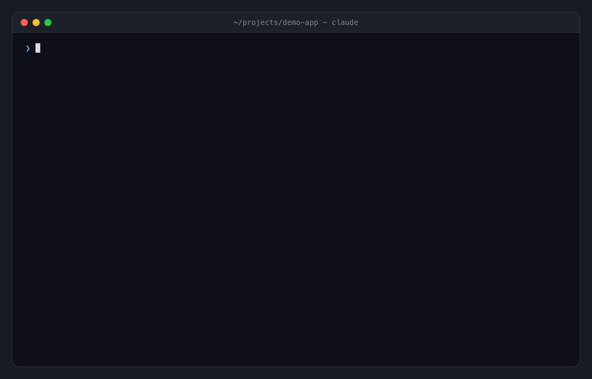

# fresh-clone

**Does your README still work? Claude tries it and tells you.**

A [Claude Code](https://claude.com/claude-code) skill that clones your repo into a throwaway folder, follows your README like a brand-new user, really runs every command, and reports where people get stuck. Then it tells you what to **add** and what to **remove**, with the reason for each, and walks you through the fixes one at a time.



```
/fresh-clone
```

---

## Why

You wrote the README once. Since then you renamed a script, moved a config file, and added an env var. You never followed your own README again, so you never noticed.

The next person who does gets stuck at step 3. They open an *"installation doesn't work"* issue, or they quietly leave.

`fresh-clone` is that next person, except it reports back.

## What it does

- **Really runs your README.** Every command, in a fresh clone, with timeouts. Servers are started, their URLs are checked, then they're stopped.
- **Times it.** Every report has one headline number: *time to first run*. Fix the README and watch it go from `never` to `9s`.
- **Tells you what to add and remove, and why.** Every suggestion cites evidence: the commit that renamed the script, the line that reads the env var, the badge that 404s.
- **Asks before it touches anything, one fix at a time.** Each fix is a Yes / No question, with *Other* to say it your own way (*"yes, but call it APP_SECRET"*).
- **Opens a pull request** with the fixes you accepted, on a new branch. Your current branch is never touched.
- **Clean-machine mode.** Optionally runs in an empty Docker container, so it catches the prerequisites your README forgets (*"you never said Node is required"*).
- **Checks your translations.** `README.tr.md` still says `npm start`? It finds that too.

## What you get

```markdown
# fresh-clone report: demo-app

## Result: 1/7 steps work · time to first run: never (blocked at step 1; 9s with workarounds)

| # | Step                       | Result | Time | What happened                                                   |
|---|----------------------------|--------|------|-----------------------------------------------------------------|
| 1 | git clone github.com/…     | ❌     | 0.8s | "Repository not found": the URL in the README is wrong         |
| 2 | cd demo-app                | ✅     | 0.0s | ok                                                              |
| 3 | npm install                | ⚠️     | 0.8s | works, but CI runs `npm ci` and there's no lockfile committed   |
| 4 | cp .env.example .env       | ❌     | 0.0s | file doesn't exist; replaced by .env.sample in 6f2b9b3          |
| 5 | npm run seed               | ❌     | 0.1s | "Missing script": removed in 6f2b9b3 ("drop seeding")          |
| 6 | npm start                  | ❌     | 0.1s | renamed to `dev`; and even then exits: "Missing SESSION_SECRET" |
| 7 | "Then open the dashboard." | 🤷     | –    | no URL given (it's http://localhost:5173, checked: 200 OK)      |

**Where a new user gets stuck first:** step 1.

## Add this, because…
- **SESSION_SECRET and PORT** → read in src/server.js; the app exits without SESSION_SECRET.
- **"Open http://localhost:5173, you should see 'Demo dashboard'"** → port changed from 3000 in 6f2b9b3.
- **Node >= 20** → package.json `engines` enforces it and CI uses Node 20.

## Remove this, because…
- **`npm start` → `npm run dev`** → renamed in 6f2b9b3.
- **`npm run seed`** → the seed script was deleted in 6f2b9b3.
- **Travis CI badge** → renders "build unknown"; CI moved to GitHub Actions.
- **Link to docs/architecture.md** → the file has never existed in git history.

## Repo fixes (not README)
- **Load .env in the dev script** (`node --env-file=.env …`) → copying the file does nothing today.
- **Commit package-lock.json** → CI's `npm ci` fails on a fresh clone without it.

## Translations
- **README.tr.md** → still says `.env.example`, `npm start` and port 3000.
```

Then, one question at a time:

```
Fix 4 of 12 ●●●●○○○○○○○○
Remove the "npm run seed" step?
That script was deleted in 6f2b9b3, so the command always fails.

  ❯ 1. Yes, remove it
    2. No, keep it
    3. Other: type your own answer…
```

## Install

```bash
git clone https://github.com/vSkyfall/fresh-clone ~/.claude/skills/fresh-clone
```

That's it. Claude Code picks it up automatically. Or install it just for one project by cloning into `.claude/skills/fresh-clone` inside that repo.

## Use

In any repo, ask Claude:

- `/fresh-clone`
- "does my README still work?"
- "would a new contributor get stuck setting this up?"
- "check github.com/someone/project's install instructions"
- "clean up my README before I open-source this"

## How it works

1. **Fresh clone** into a temp folder. Your working copy, branches and uncommitted changes are never touched.
2. **Pick the machine.** If Docker is running, it asks whether to test on a clean container or on your computer.
3. **Collect facts** with a small bundled script: package managers, version pins, scripts, env vars the code actually reads, CI config, translations, broken local links.
4. **Turn your README into a checklist** of what a new user is told to do.
5. **Run and time every step for real.**
6. **Diagnose failures** using git history ("renamed in commit abc123"), not guesses.
7. **Compare README vs. facts** to produce the *add / remove / repo fixes / translations* lists.
8. **Ask about each fix, one at a time**, then apply only what you accepted.
9. **Offer a PR**, then offer a re-test so you see the before/after.
10. **Clean up**: temp clone deleted, servers stopped, container removed.

### Results legend

| | Meaning |
|---|---|
| ✅ | works |
| ⚠️ | runs, but not what the README says (wrong port, extra step needed) |
| ❌ | broken |
| ⏭️ | needs a human (real API key, paid account, sudo); skipped, not counted as a failure |
| 🤷 | the README doesn't say enough to know what to do |

## Safety

- Everything runs in a temporary clone that's deleted at the end.
- On your computer: no `sudo`, no global installs, no `curl | sh` from third-party domains. (Inside the disposable Docker container, it installs whatever your README says.)
- Secrets are never invented; steps that need real keys are marked ⏭️.
- Nothing in your repo changes unless you say yes, fix by fix. PRs go on a new branch.

## Works with

Anything with a README: JavaScript/TypeScript, Python, Go, Rust, Ruby, Docker, Makefiles… The skill reads your instructions, not your language.

Needs `bash`, `git` and `perl` (preinstalled on macOS and most Linux; use WSL on Windows). Optional: Docker for clean-machine mode, the `gh` CLI for opening PRs.

## Contributing

Issues and PRs welcome, especially:
- Repos where the report got something wrong (please include the README)
- Better fact detection for more ecosystems in `scripts/fresh_clone.sh`

The demo GIF is generated from code; see [assets/demo-src](assets/demo-src).

## License

MIT
